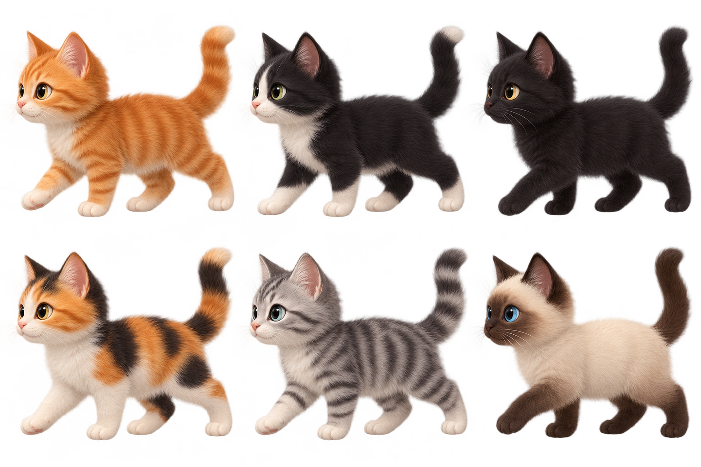

# Minute Cat

A cat walks across the bottom of your screen when the app starts and every minute after that. Each walk lasts about 10 seconds. The cats now use soft, realistic 3D-style artwork with two walking poses. Click a cat to show it some love.



The control window lets you preview a walk with **Show now**, **Pause** or **Resume** automatic walks, choose a specific cat, and **Quit** at any time. **Surprise me** rotates through six looks: orange tabby, tuxedo, black cat, calico, silver tabby, and Siamese. Keep the control window running for reminders to continue.

The walking cat stays on top. On Windows, its background is transparent; other desktops may show a small light background behind it.

Requires Python 3 with Tkinter and a graphical desktop. Keep the `assets` folder beside `cat_reminder.py`. From this directory, run:

```sh
python3 cat_reminder.py
```

On Windows, use `py cat_reminder.py` instead. Keep the app running for the reminders to continue.

Run the timing test with:

```sh
python3 -m unittest -v
```
